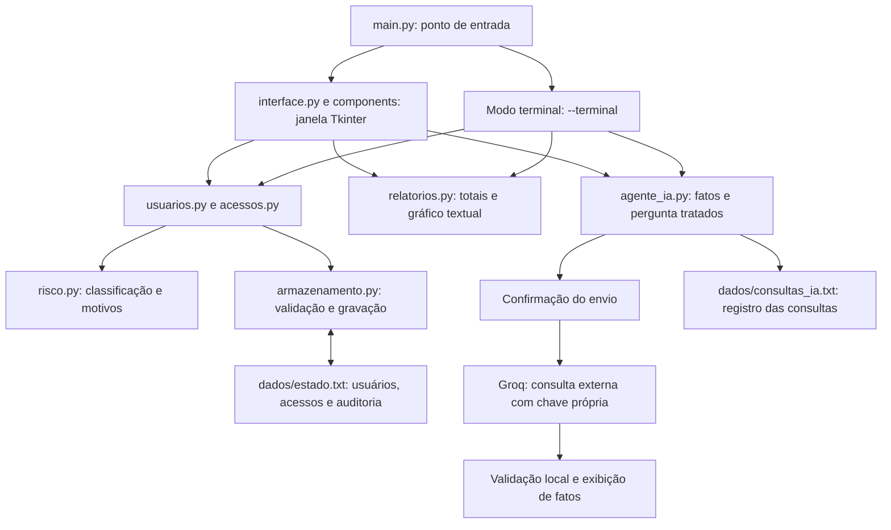
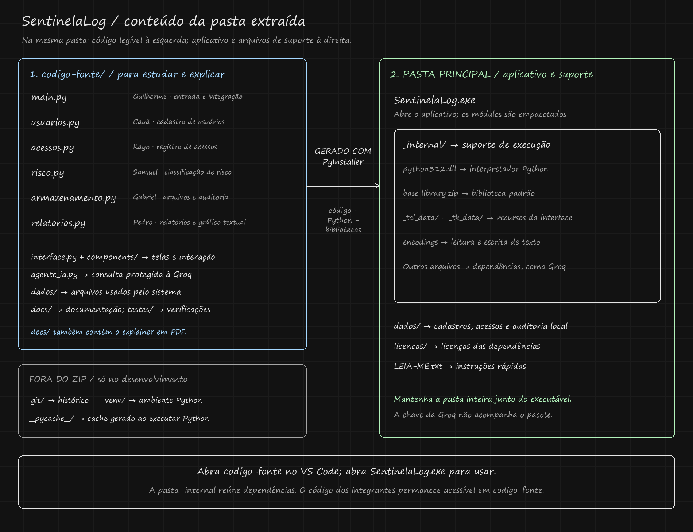

# Arquitetura e organização dos arquivos

O SentinelaLog é uma aplicação local de registro de acessos fictícios. O núcleo usa funções Python; a interface gráfica e o modo terminal utilizam os mesmos módulos. Somente a consulta de IA se conecta à internet, por HTTPS com a Groq.

## Fluxo de uma operação



A classificação acompanha o registro do acesso; a confirmação de sucesso ocorre após a gravação. Os relatórios calculam resultados a partir do estado carregado. A IA seleciona fatos previamente calculados e não recebe autorização para alterar arquivos ou executar comandos.

## Código dos integrantes

A tabela indica a divisão de responsabilidades do grupo. Os arquivos podem ter recebido ajustes de integração; o histórico Git preserva os autores de cada alteração.

| Integrante | Arquivo do módulo | Função no conjunto |
| --- | --- | --- |
| Guilherme Alcântara | `main.py` | Entrada, menu terminal e integração das operações |
| Cauã Santos | `usuarios.py` | Validação, cadastro, edição, exclusão lógica e mascaramento |
| Kayo Nascimento | `acessos.py` | Registro de eventos, consultas e máquinas compartilhadas |
| Samuel Bernardi | `risco.py` | Horários, origens bloqueadas e classificação com motivos |
| Gabriel Mendes | `armazenamento.py` | Validação, persistência em TXT e auditoria |
| Pedro Henrique | `relatorios.py` | Totais, empates, indicadores e gráfico textual |

A interface adicionada por Pedro está em `interface.py` e `components/`; a consulta Groq está em `agente_ia.py` e `components/chat_ia.py`. `components/estilos.py`, `widgets.py`, `sidebar.py`, `formularios.py` e `tabelas.py` organizam a apresentação e os controles da janela.

## Pasta extraída do download para Windows



```text
SentinelaLog/
├── SentinelaLog.exe
├── _internal/
│   ├── python312.dll
│   ├── base_library.zip
│   ├── _tcl_data/
│   ├── _tk_data/
│   └── outras dependências e arquivos de suporte
├── dados/
│   └── bloqueadas.txt
├── licencas/
├── codigo-fonte/
│   ├── main.py, usuarios.py, acessos.py
│   ├── risco.py, armazenamento.py, relatorios.py
│   ├── interface.py, agente_ia.py
│   ├── components/, dados/, docs/, testes/
│   │   (explainer em docs/SentinelaLog_Explainer.pdf)
│   └── requirements.txt e demais arquivos do repositório
├── LEIA-ME.txt
└── COMO-VER-OS-CODIGOS.txt
```

`estado.txt` e `consultas_ia.txt` são criados na pasta de dados conforme as operações são realizadas. O pacote Windows começa sem cadastros ou acessos.

| Item | Por que existe |
| --- | --- |
| `SentinelaLog.exe` | Abre a aplicação; contém o ponto de entrada e módulos empacotados |
| `_internal/python312.dll` | Interpretador Python incluído para dispensar sua instalação separada |
| `_internal/base_library.zip` | Parte da biblioteca padrão do Python, incluindo suporte a codificações de texto |
| `_internal/_tcl_data/`, `_tk_data/` e `tcl8/` | Recursos do Tcl/Tk usados para desenhar a interface Tkinter |
| Demais arquivos de `_internal/` | Extensões nativas, certificados HTTPS e dependências da integração Groq |
| `dados/` | Registros locais da distribuição executável e lista de bloqueadas |
| `licencas/` | Textos das licenças das dependências distribuídas |
| `codigo-fonte/` | Arquivos legíveis para estudar, explicar ou executar com Python |
| `codigo-fonte/docs/SentinelaLog_Explainer.pdf` | Explainer técnico e instruções de uso em PDF |

O empacotamento com PyInstaller reúne o código e o ambiente de execução. Essas dependências não representam novos módulos de negócio desenvolvidos pelos integrantes. Mantenha a pasta inteira: copiar somente o `.exe` não é suficiente. A distribuição é para Windows 64 bits; outras plataformas usam o código-fonte com ambiente compatível.

## Abrir e estudar

1. Extraia o ZIP inteiro.
2. Para usar: abra `SentinelaLog.exe` na pasta principal.
3. Para ler os códigos: no VS Code, use **Arquivo → Abrir Pasta** e escolha `codigo-fonte`.
4. Clique no `.py` indicado na tabela do integrante. Para a tela, abra `interface.py` e os arquivos de `components/`.
5. Para executar os `.py`, instale Python e as dependências conforme o [manual](manual.md). A simples leitura no editor não exige essas instalações.

Editar o fonte não modifica o executável existente. A base de dados do executável e a base de `codigo-fonte/dados/` são independentes. Execute uma única instância por pasta de dados.

## Repositório e distribuição

O repositório GitHub mantém os módulos na raiz e as pastas `components/`, `dados/`, `docs/` e `testes/`. Releases oferece o ZIP adicional com aplicativo e fonte. A pasta `_internal` não deve ser copiada para a raiz do repositório.

Na máquina de desenvolvimento podem existir `.git/` (histórico), `.venv/` (ambiente local) e `__pycache__/` (cache). Eles não são necessários no ZIP para leitura do código e não fazem parte dos módulos do grupo. Não distribua chaves, arquivos `.env`, bases de uso pessoal ou logs de consultas.

## Escopo e limites

A aplicação registra eventos informados pelo operador; não monitora automaticamente o sistema operacional, não grava a tela e não funciona como antivírus. As matrículas são fictícias e estáveis. Mascaramento não é criptografia. O assistente requer internet e chave própria; funções locais continuam disponíveis sem esses recursos. Consulte [segurança](seguranca.md) e o [manual](manual.md).
